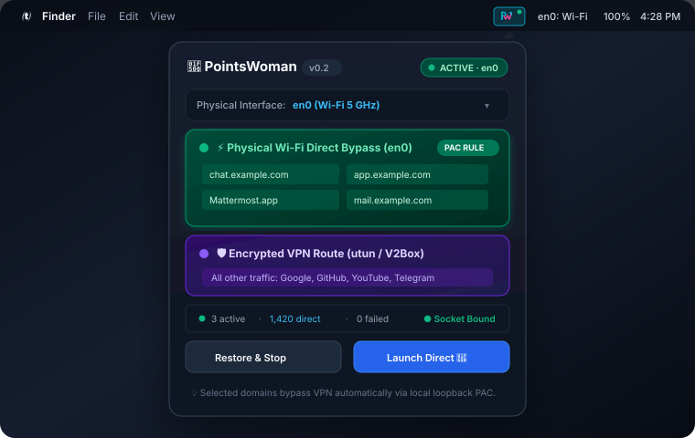

<div align="center">

# 🔀 PointsWoman
**Intelligent macOS network switch directing selected domains & apps through physical Wi-Fi, bypassing VPN tunnels.**

[](#)
[](#)
[](#)
[](#)
[](#)
[](#)
[](LICENSE)

<br/>



</div>

---

### ✨ Features

- **⚡ Physical Interface Egress**: Binds outbound TCP/IP sockets directly to physical hardware (`en0` via Darwin `IP_BOUND_IF`), sending whitelisted traffic straight through physical Wi-Fi without traversing active VPN tunnels (V2Box, OpenVPN).
- **🎯 Precision PAC Routing**: Serves a local Proxy Auto-Config script (`127.0.0.1:17839/proxy.pac`) that selectively routes whitelisted hostnames (`chat.example.com`, `app.example.com`, `mail.example.com`) directly, leaving all other internet traffic encrypted over VPN.
- **🚀 Direct App Launcher**: Launch Electron & Chromium applications (Mattermost, Google Chrome, Edge) with dedicated launch arguments for full-session physical network bypass.
- **🛡️ 100% Reversible State**: Automatically snapshots system proxy preferences before making changes. Restore previous network and VPN settings cleanly with a single click or command.
- **🪶 Ultra-Lightweight & Native**: 100% native Swift 5.10 with SwiftUI & AppKit. Consumes only **~18 MB RAM**, **0.0% idle CPU**, and requires no kernel extensions or third-party drivers.
- **💻 Menu Bar GUI & CLI**: Control everything from the sleek macOS menu bar accessory or automate workflows via the standalone `pointswomanctl` CLI.

---

### 🚀 Quick Start

#### Option 1: Open Prebuilt App
```bash
git clone https://github.com/Reera-t/PointsWoman.git
cd PointsWoman
open dist/PointsWoman.app
```
Look for the switch icon (`🔀`) in your top Mac menu bar.

#### Option 2: Install Standalone CLI
```bash
./dist/pointswomanctl install-cli
pointswoman serve --interface en0
```

---

### ⌨️ How To Use

| Mode | Action | What It Does |
| :--- | :--- | :--- |
| **Website Proxy** | Click **Enable for network** | Selected domains (`chat.example.com`) bypass VPN directly via `en0` |
| **Direct App Launch** | Click **Launch Direct 🚀** | Entire app session (e.g. Mattermost) routes through physical Wi-Fi |
| **Restore & Stop** | Click **Restore & Stop** | Reverts macOS proxy settings to the exact pre-launch state |
| **Diagnostics** | Run `pointswomanctl doctor` | Displays physical network interfaces, PAC status, and routing tables |

---

### 🧪 Automated Tests

```bash
./scripts/test.sh    # 33 unit checks + 15 integration tests pass
```

---

<div align="center">

MIT License • Created with ❤️ by [Reera Tehranizadeh](https://github.com/Reera-t)

</div>
